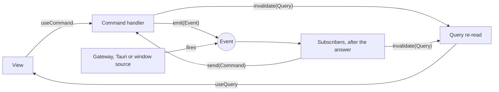
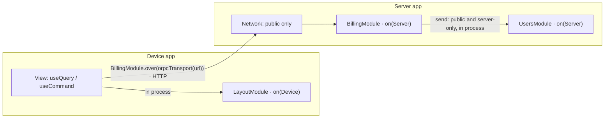
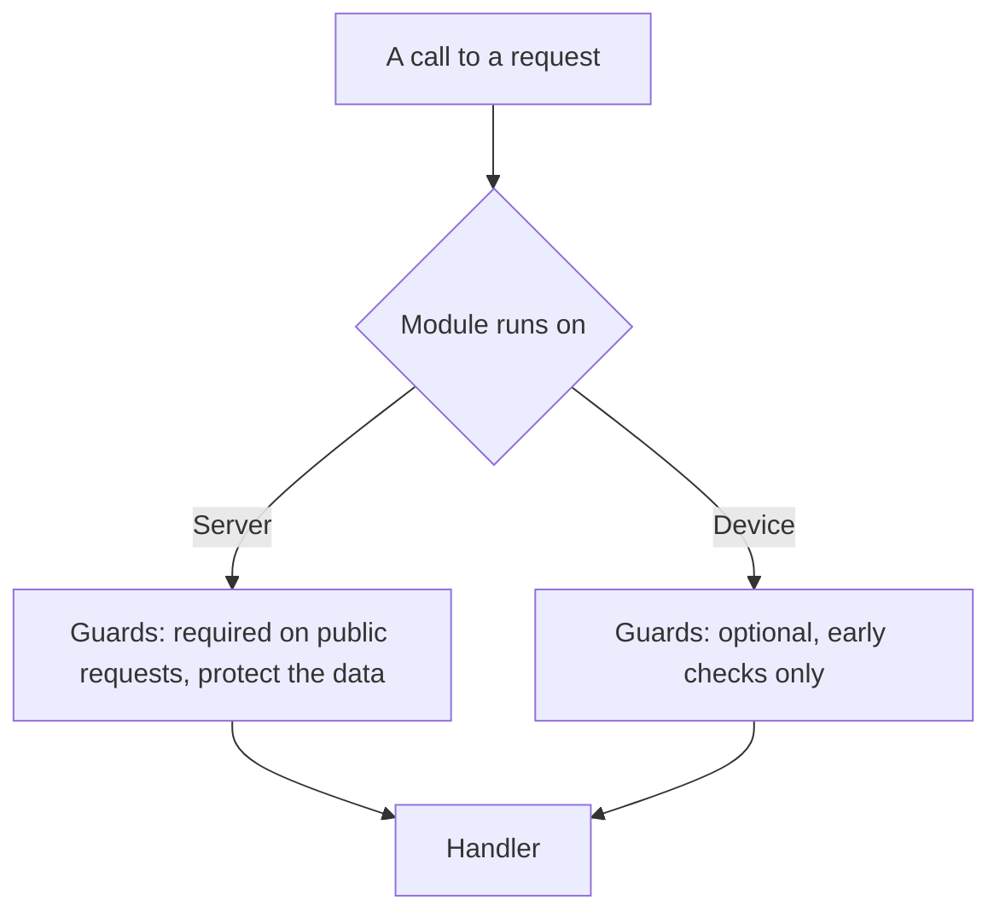

# Architecture

The rules every developer and every agent follows when writing code in this repository. Read this page first; the pages below go deeper.

| Page                           | Answers                                                                                          |
| ------------------------------ | ------------------------------------------------------------------------------------------------ |
| [layers.md](layers.md)         | what a handler, a gateway, lib, a schema, a module and a view may do, with bad and good examples |
| [requests.md](requests.md)     | requests, modules, sending, guards, the mediator, idempotency, starting an app and a server      |
| [views.md](views.md)           | client packages, blocks, layouts, slots, how a view reads and writes, loading, error and empty   |
| [placement.md](placement.md)   | where each file goes, the two package shapes and their entries                                   |
| [code-style.md](code-style.md) | names, injected keys, logging, the shape of a request, a module, a block and a gateway           |
| [hosts.md](hosts.md)           | the facts a host hands an app, keeping one platform's code out of another's bundle, deploy, env  |
| [lint.md](lint.md)             | the checks that hold every rule here                                                             |
| [apps.md](apps.md)             | Sumi as a shell: app repositories, the contract, versioning, registry, install and updates       |
| [legacy.md](legacy.md)         | code written before these rules: `legacy/` folders and the older module shape                    |

> Status: `packages/state/layout` (data) and `packages/client/shell` (its views) are the reference pair. Every other package under `packages/domain/` and `packages/client/mascot` still has the older module shape ([legacy.md](legacy.md#the-older-module-shape)). A rule marked **planned** is not built or not checked by a tool yet.

## In one page

**What it is.** A modular monolith that can be split into services without rewriting code (like Encore.ts, Google Service Weaver). You write a command or a query once; the same code runs on the device, in one server, or across several servers, typed end to end (like tRPC). Where a module runs is one line in the app; only how much its checks protect changes.

**Why not a plain REST API.** With REST every endpoint is written twice (a server route and a client fetch), its types are kept in sync by hand, and what runs on the server is decided on day one. Here a request is written once, its types travel with it, and it moves between the device and a server without a rewrite.

**Requests: CQRS.** A query reads, a command writes (CQRS; as `useQuery` / `useMutation` in TanStack Query, `query` / `mutation` in tRPC, requests and handlers in MediatR). A request carries its contract (zod input and output) and its handler. Views call `useQuery` / `useCommand`; nothing else reaches logic.

**Modules.** A module is one area's data: its commands and queries, their storage (gateways) and their rules (like NestJS or Medusa modules). It declares what it is and which of its commands and queries others may use:

```ts
export const BillingModule = module("billing")
	.on(Server)
	.imports(UsersModule)
	.public(InvoicesQuery, ChargeCommand)
	.serverOnly(CreateCustomerCommand)
	.provide((facts) => billingPartsOn(facts));
```

- `.on(Server | Device | Anywhere)`: where the module may run.
- `.public(...)`: the module's API: the commands and queries any caller may use (views, other modules, the network) and the events other modules may subscribe to. An event not listed is private: only the module's own subscribers hear it, and it never enters the contract.
- `.serverOnly(...)`: the module's commands and queries that never cross the network. On a server, other server modules in the process may use them; on a device (an `Anywhere` module run in an app), only the module's own handlers. Not on a `Device` module: a type error says why.
- `.imports(...)`: the other modules whose commands and queries this module's handlers send: their public ones always, their server-only ones when this module runs on a server too.
- `.subscribers(...)`: what the module reacts to: subscribers of its own events, private or public, and of public events of the modules it imports (below).
- `.needs({ vault: Vault })`: live objects the host lends (an Obsidian vault, a running agent); `provide` receives them as `host`, and the app's `start({ host })` must give them.

**Re-reading: `invalidate`.** A command or a subscriber calls `invalidate(Query, input?)` for each query its work made stale (like `revalidatePath` / `revalidateTag` in Next.js server actions, or `invalidateQueries` in TanStack's `onSuccess`). Invalidations apply only after a successful answer; a refused or failed call re-reads nothing, and a command that invalidates nothing re-reads nothing. Over the network the names ride in the answer (`invalidated: [...]`) and the client re-reads them.

**Events.** An event is a fact in the past tense (`PanesChangedEvent`), with an input schema. A handler emits one of its own module's events (`emit(PanesChangedEvent)`, typed by the handler's `.emits`); or it comes from outside: `event("panes-changed").from(gatewayEvent(PaneTreeGateway, (gateway, fire) => gateway.treeChanged(fire)))`, `tauriEvent(name)`, `windowEvent(type)`, per platform or for all. A subscriber handles it: `subscriber(PanesChangedEvent).handle((input, { invalidate, send }) => ...)`. Subscribers run after the emitter has answered, each on its own: one failing is reported and touches nothing else. **A view reads with useQuery and acts with useCommand; events are inside modules: subscribers handle them and call invalidate to re-read queries. A view never emits or subscribes to an event.**



**Apps.** An app is shaped like a module: `.modules(...)` run inside it, `.imports(Module.over(transport))` are reached through a transport (HTTP, IPC, in process), by the same calls. An app with views is a device app (React); a server is an app too (Hono). A monolith lists every module in one server's `.modules`; a service is a module moved to another server and imported over a transport to it. The module's code does not change.

```ts
app()
	.modules(LayoutModule)
	.imports(BillingModule.over(orpcTransport(env.API_URL)))
	.start({ platform, scope });
server().modules(BillingModule, UsersModule).start({ env: process.env });
```



**Guards.** A guard is the same code everywhere: it refuses a call before the handler runs (no user, not the owner, a transition that is not allowed). On a server it protects the data, because nobody can reach past it; a server module's public request must have one. On a device it is an ordinary early check, optional: it keeps the app from doing what makes no sense, but anyone can send a request by hand past it, so it protects nothing.



**What a package exports.** `"."` holds the public contract and the module's descriptor, enough to call it at a URL and nothing that runs; `"./server"` holds the server-only contract, imported only by server modules; `"./module"` holds the module with its handlers and gateways, imported only by the app that runs it. A device bundle therefore carries the code of the modules it runs and the contracts of the ones it imports, never a server module's code.

### Starting a module or a feature

Always `widgetarium add module` and `widgetarium add feature` (in this repo `npm run widgetarium -- add …`), never by hand. The shapes they lay are the reference: replace the example data, keep the shape. What each lays is in [placement.md](placement.md#starting-a-module-or-a-feature).

```sh
widgetarium add module notes --on Device            # Server | Device | Anywhere; --in state for app state
widgetarium add feature notes/tasks --command AddTask  # --query Tasks is the default; both may be given
```

## Layers

```
apps/                 a product you deploy or a host: studio, server, host-obsidian, host-tauri
   ↓
packages/client/      views: React blocks reading and writing data modules through requests
   ↓
packages/domain/      data modules of a business area (chats, tabs, billing); may run on a server
packages/state/       data modules of the app's own state (layout); run where the app runs
   ↓
packages/shared/      code with no domain: core (requests, mediator, hooks), kit, behaviors, cli, eslint-plugin
```

`domain` and `state` are the same kind of package, a **data module** (`module(...)`, `"level": "domain"`), with the same rules; the folder only says what the data is about. A client package declares `"level": "client"`; a shared one `"level": "common"`.

## Three rules

1. **Imports go one way: `apps` → `client` → `domain`/`state` → `shared`.** A package never imports an app. A package reaches a data module only through its `"."` entry, the generated contract.
2. **A file's place is what it is.** A request and its handler → `features/<feature>/requests.ts`. What is drawn → a client package. Storage or an outside system → `gateways/`. A pure computation → `lib/`. Which gateway a platform gets → the module's `provide`.
3. **Nothing reaches for anything.** A view sends requests through `useQuery` / `useCommand`. A handler declares what it needs in `.inject` and receives it as an argument. A host hands the app facts (platform, workspace, env), never gateways. No hidden globals, no singletons.

## Names

| Declares                      | Written                                                        | Named                       | Example                  |
| ----------------------------- | -------------------------------------------------------------- | --------------------------- | ------------------------ |
| a read and its handler        | `query("<short-name>").output(…).inject({…}).handle(fn)`       | noun phrase + `Query`       | `FrameSidesQuery`        |
| a write and its handler       | `command("<short-name>").input(…).idempotencyKey(…)….handle()` | verb phrase + `Command`     | `ToggleFrameSideCommand` |
| a data module                 | `module("<name>").on(…).public(…).serverOnly(…).provide(fn)`   | its area + `Module`         | `LayoutModule`           |
| who may call                  | `guard<In>().inject({…}).handle(check)`                        | what it checks + `Guard`    | `OwnsInvoiceGuard`       |
| what wraps a call             | `middleware().inject({…}).handle(fn)`                          | what it does + `Middleware` | `TimingLoggerMiddleware` |
| storage or an outside system  | `abstract class`, its own token                                | its data + `Gateway`        | `FrameSidesGateway`      |
| one storage's implementation  | `class … extends FrameSidesGateway`                            | `<Storage><Name>Gateway`    | `TauriFrameSidesGateway` |
| reading and writing in a view | `useQuery`, `useOptionalQuery`, `useCommand`                   | —                           | —                        |

A request's string name is short: the constant without its suffix, in kebab case (`ToggleFrameSideCommand` → `"toggle-frame-side"`). The module stamps it `<module>/<short>` when it lists it, so the module name is never written twice. Every declaration is a fluent chain and every behaviour ends in `.handle()` ([code-style.md](code-style.md#the-fluent-chain)).

## Imports

| From ↓ may import → | app | client package | data module                                                                                          | shared |
| ------------------- | --- | -------------- | ---------------------------------------------------------------------------------------------------- | ------ |
| app                 | own | its `"."`      | its `"."`; its `"./module"` to start it                                                              | yes    |
| client package      | no  | its `"."`      | its `"."`                                                                                            | yes    |
| data module         | no  | no             | its `"."` (and `"./server"` when both run on a server), declared in `package.json` and in `.imports` | yes    |
| shared              | no  | no             | no                                                                                                   | yes    |

A data module never imports React; a client package never imports `"./module"` or a gateway. The graph of packages has no cycle.

## Prior art

| Source                              | Taken                                                                                       |
| ----------------------------------- | ------------------------------------------------------------------------------------------- |
| MediatR, NestJS CQRS                | a request is sent to a bus; the handler is found by the request's name                      |
| Elm, Redux, LiveStore, Linear       | state is data, a view is a function of it; UI state lives in the same store as data         |
| Medusa v2                           | a module owns its data; modules meet through ids and requests, never each other's internals |
| TanStack Start, Next `"use server"` | server code is cut by the build, not by discipline                                          |
| tRPC, oRPC, Convex                  | one typed contract shared by client and server; a server request is called like a local one |
| NestJS guards                       | every server request names who may call it; a guard reads the user, never verifies a token  |
| TanStack Query                      | the cache under the hooks: dedup, stale time, structural sharing on a re-read               |
| Stripe idempotency keys             | a write runs once per key, keys scoped per account                                          |
| Spring Modulith, Packwerk           | module boundaries held by a tool                                                            |
| Radix                               | behavior ready-made, the look written by the project                                        |

Research behind this page: [data and views](https://claude.ai/artifact/MYdpuvFAuBnssVzkZ1W4Mt), [a simpler architecture](https://claude.ai/artifact/XkjuHUsXeX65WK4bfzEAiC), [coupling between domains](https://claude.ai/artifact/XbHJNHvW3Fr1xGB1zgUkQV), [CQRS](https://claude.ai/artifact/BTCZLhbBiiRsEP4qAV5b1d), [oRPC](https://claude.ai/artifact/CyifG8Aq9SegsBXvWNM2i7).
